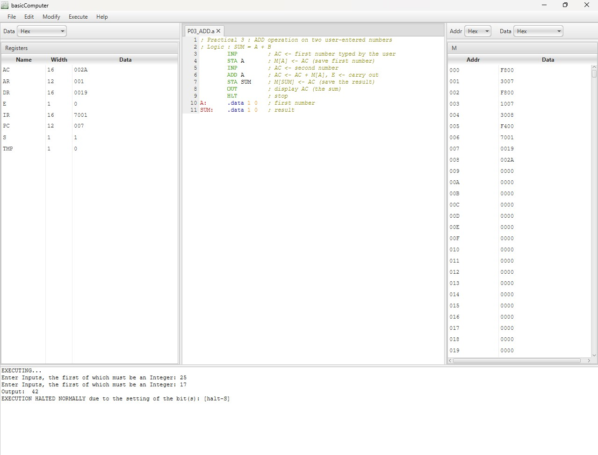
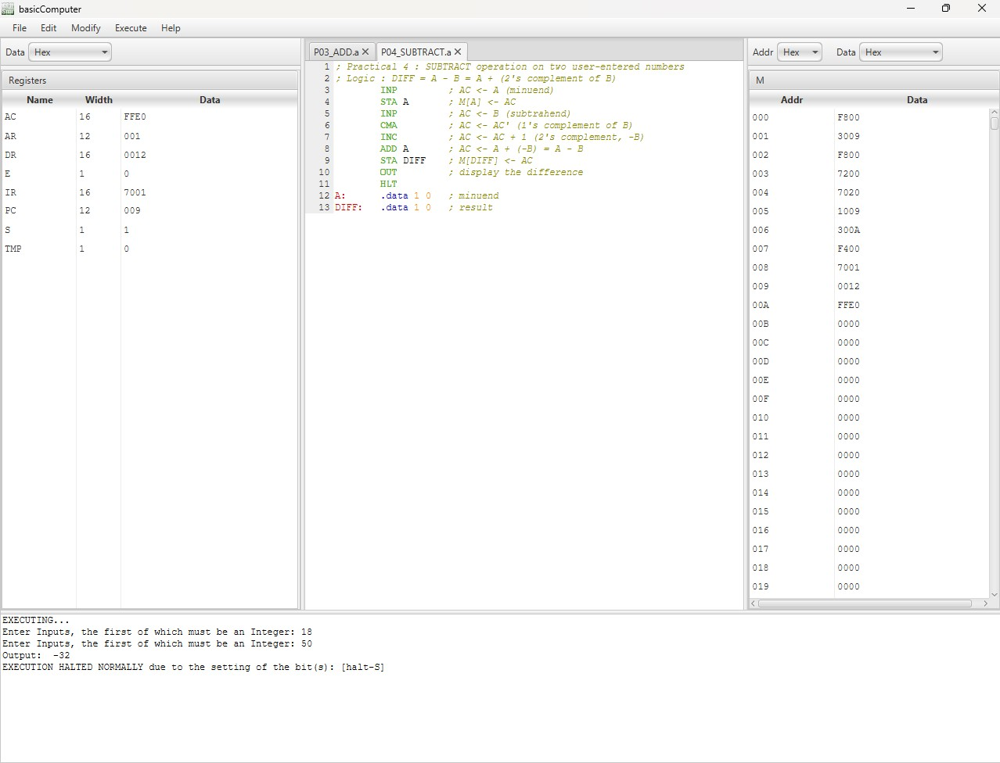
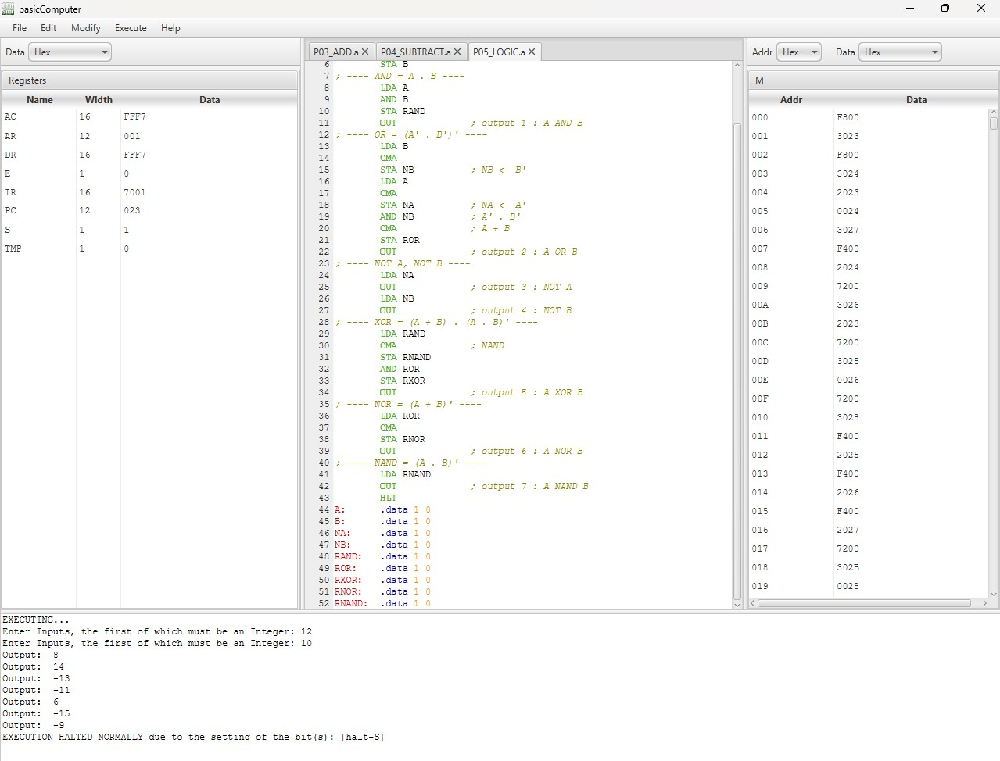
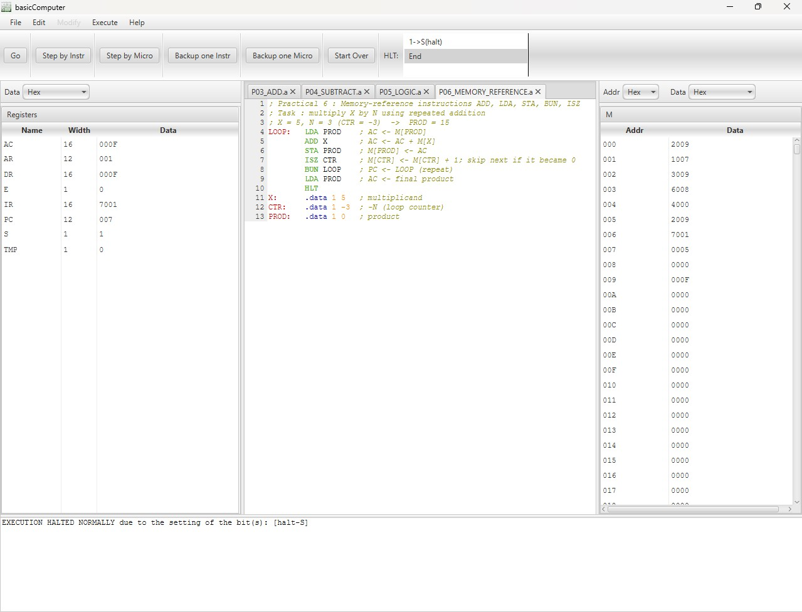
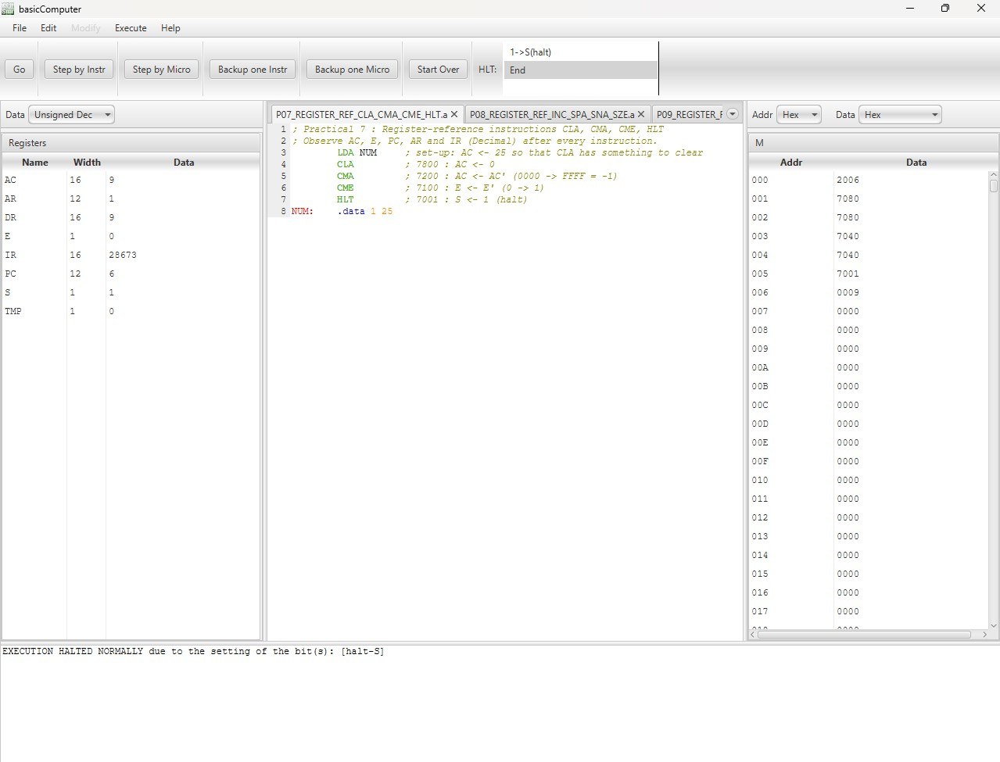
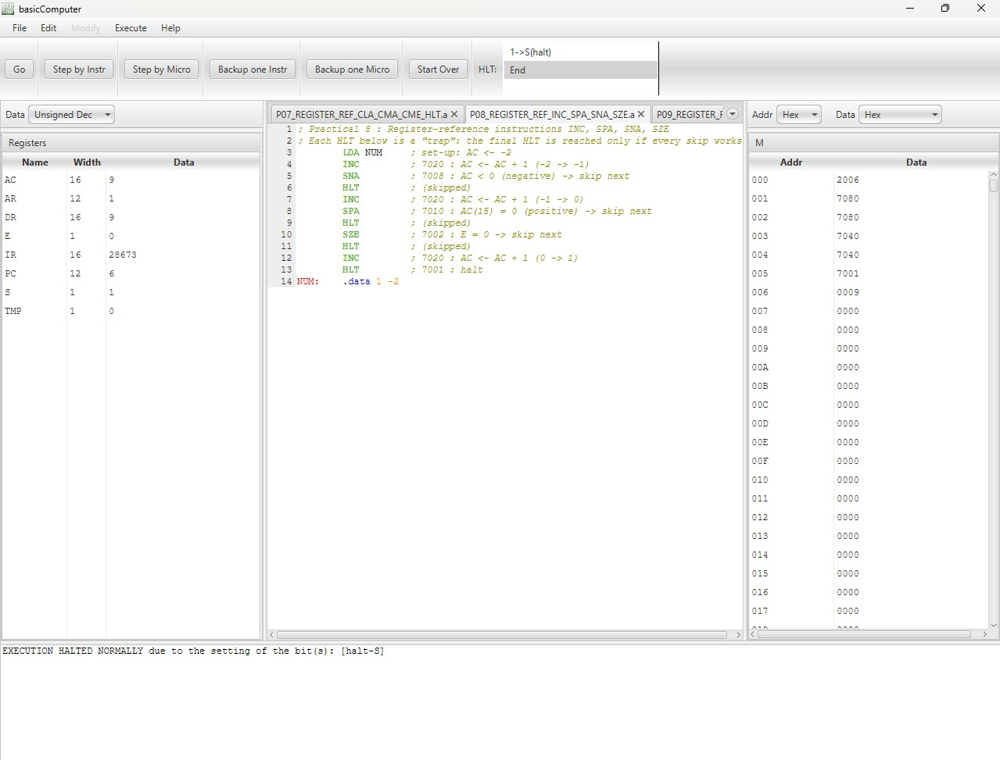
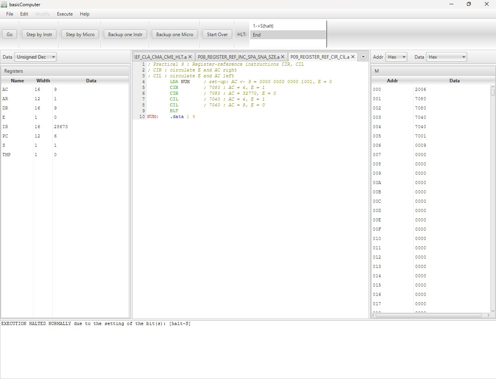
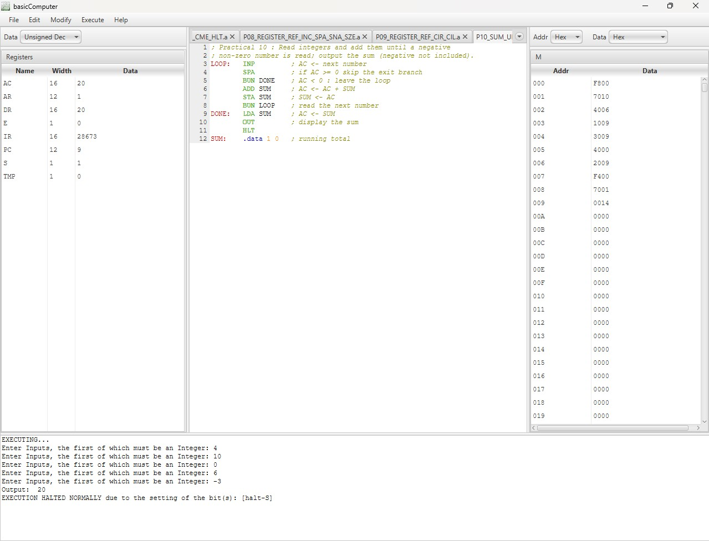
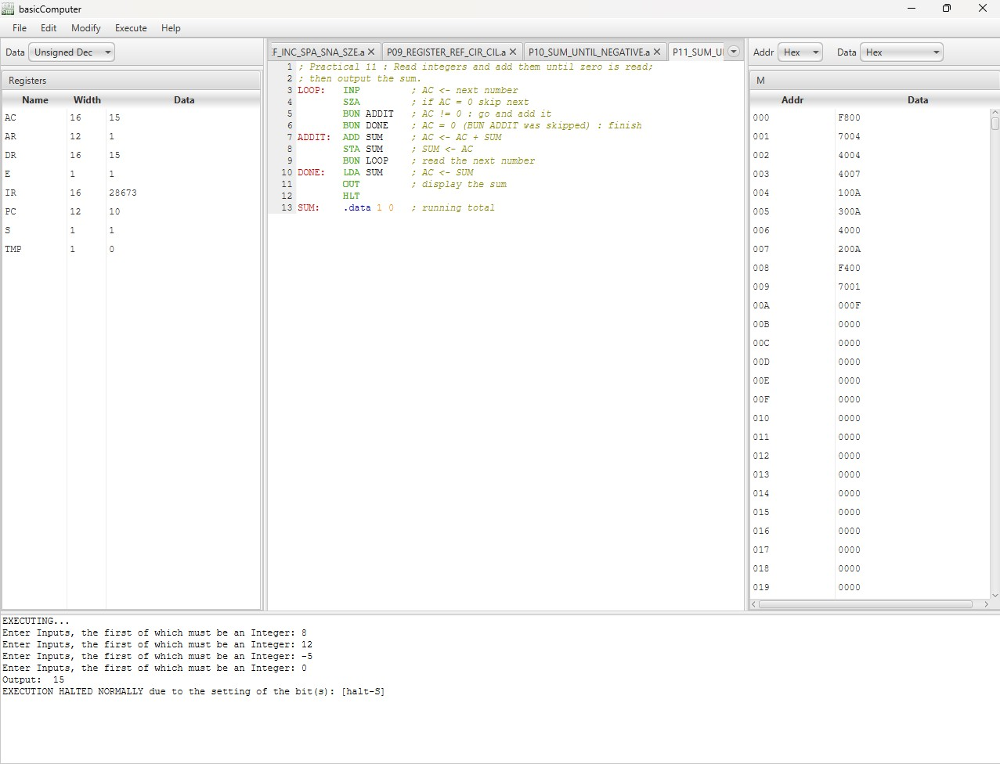

# Computer System Architecture: CPU Sim Lab

Practicals for **Computer System Architecture** (Ramanujan College, University of Delhi), written in assembly and run on a model of **Mano's Basic Computer** in **CPU Sim 4.0.11**.

Each practical below has the aim, the code, the screenshot of the run, and the observed result. The same programs are also kept as separate `.a` files in this repo.

## Repo layout

All files are in one folder:

```
README.md
csa.cpu                  # CPU Sim machine file (Practicals 1 and 2)
csa_machine.txt          # text summary: registers, RAM, instruction encodings
P03_ADD.a ... P11_SUM_UNTIL_ZERO.a     # one program per practical
P03_ADD.jpg ... P11_SUM_UNTIL_ZERO.jpg # simulator screenshots
```

## The machine

A 16-bit, single-accumulator, microprogrammed computer with a 4096-word memory.

- **RAM:** `M`, 4096 words of 16 bits.
- **Registers:** AC (16), DR (16), AR (12), PC (12), IR (16), E (1), S (1), TMP (1).
- **Halt:** `HLT` sets S = 1 and the run stops.
- **Fetch routine:** `PC->AR`, `M[AR]->IR`, `PC+1->PC`, `IR(0-11)->AR`, `decode-IR`.

| Type | Instructions | Encoding |
|---|---|---|
| Memory reference | AND, ADD, LDA, STA, BUN, ISZ | opcode digit 0 1 2 3 4 6 + 12-bit address |
| Register reference | CLA, CLE, CMA, CME, CIR, CIL, INC, SPA, SNA, SZA, SZE, HLT | 7xxx (e.g. CLA = 7800, HLT = 7001) |
| Input / Output | INP, OUT | F800, F400 |

**Assembler.** `LABEL: .data 1 value` reserves one word holding `value`. `INP` reads an integer into AC and `OUT` prints AC.

**How to run.** Open the machine with *File → Open machine*, open a `.a` file with *File → Open text*, then *Execute → Assemble & load* (Ctrl+2) and *Run* (Ctrl+R). For the register-trace practicals use *Debug Mode* (Ctrl+D) and *Step by Instr*.

## Practicals

| No. | Practical | Program |
|---|---|---|
| 1 | Create a machine (Basic Computer) | [csa.cpu](csa.cpu) |
| 2 | Fetch routine of the instruction cycle | [csa.cpu](csa.cpu) |
| 3 | ADD two user-entered numbers | [P03_ADD.a](P03_ADD.a) |
| 4 | SUBTRACT two user-entered numbers | [P04_SUBTRACT.a](P04_SUBTRACT.a) |
| 5 | AND, OR, NOT, XOR, NOR, NAND | [P05_LOGIC.a](P05_LOGIC.a) |
| 6 | ADD, LDA, STA, BUN, ISZ | [P06_MEMORY_REFERENCE.a](P06_MEMORY_REFERENCE.a) |
| 7 | CLA, CMA, CME, HLT | [P07_REGISTER_REF_CLA_CMA_CME_HLT.a](P07_REGISTER_REF_CLA_CMA_CME_HLT.a) |
| 8 | INC, SPA, SNA, SZE | [P08_REGISTER_REF_INC_SPA_SNA_SZE.a](P08_REGISTER_REF_INC_SPA_SNA_SZE.a) |
| 9 | CIR, CIL | [P09_REGISTER_REF_CIR_CIL.a](P09_REGISTER_REF_CIR_CIL.a) |
| 10 | Sum of integers until a negative number | [P10_SUM_UNTIL_NEGATIVE.a](P10_SUM_UNTIL_NEGATIVE.a) |
| 11 | Sum of integers until zero | [P11_SUM_UNTIL_ZERO.a](P11_SUM_UNTIL_ZERO.a) |

---

## Practical 1: Create a machine (Basic Computer architecture)

**Aim.** Create, in CPU Sim, a machine based on the Basic Computer architecture: its registers, memory, microinstructions, instruction fields and machine instructions.

**What was built.** File: [csa.cpu](csa.cpu).

- 8 registers: AC, DR, AR, PC, IR, E, S, TMP.
- 2 condition bits: `carry-E` (register E) and `halt-S` (register S, halt = yes).
- RAM `M`: 4096 cells of 16 bits.
- Microinstructions of every type: TransferRtoR, MemoryAccess, Increment, Arithmetic, Logical, Shift, Set, Test, Decode, SetCondBit, IO.
- 3 instruction fields: `op` (4 bits), `addr` (12 bits), `opcode` (16 bits).
- 20 machine instructions: AND, ADD, LDA, STA, BUN, ISZ, CLA, CLE, CMA, CME, CIR, CIL, INC, SPA, SNA, SZA, SZE, HLT, INP, OUT.

**Result.** A machine based on the Basic Computer architecture was created in CPU Sim and saved as a `.cpu` file.

---

## Practical 2: Fetch routine of the instruction cycle

**Aim.** Create the fetch (and decode) routine of the instruction cycle and observe it one microinstruction at a time.

**Fetch sequence.**

```
T0 : AR <- PC                      PC->AR
T1 : IR <- M[AR], PC <- PC + 1     M[AR]->IR, PC+1->PC
T2 : AR <- IR(0-11), decode IR     IR(0-11)->AR, decode-IR
```

**Observed (first instruction of a program, `INP` = F800).**

| Micro-step | Microinstruction | AR | PC | IR |
|---|---|---|---|---|
| start | - | 0 | 0 | 0 |
| 1 | PC->AR | 0 | 0 | 0 |
| 2 | M[AR]->IR | 0 | 0 | 63488 (F800) |
| 3 | PC+1->PC | 0 | 1 | 63488 |
| 4 | IR(0-11)->AR | 2048 (800) | 1 | 63488 |
| 5 | decode-IR | 2048 | 1 | 63488, INP selected |

**Result.** The fetch routine was created and verified by single-stepping the first instruction of a program.

---

## Practical 3: ADD operation on two user-entered numbers

**Aim.** Read two numbers from the user, add them and display the sum.

**Code** ([P03_ADD.a](P03_ADD.a)):

```
        INP         ; AC <- first number typed by the user
        STA A       ; M[A] <- AC (save first number)
        INP         ; AC <- second number
        ADD A       ; AC <- AC + M[A], E <- carry out
        STA SUM     ; M[SUM] <- AC (save the result)
        OUT         ; display AC (the sum)
        HLT         ; stop
A:      .data 1 0   ; first number
SUM:    .data 1 0   ; result
```

**Screenshot.**



**Result.** Inputs `25` and `17` give `Output: 42`.

| Inputs | Output |
|---|---|
| 25, 17 | 42 |
| -40, 15 | -25 |
| -1, 1 | 0 (E = 1, carry out) |
| 30000, 10000 | -25536 (16-bit overflow) |

---

## Practical 4: SUBTRACT operation on two user-entered numbers

**Aim.** Read A and B and display A - B.

**Idea.** There is no subtract instruction, so A - B = A + (B' + 1): `CMA` gives the 1's complement, `INC` adds 1 to give -B, and `ADD` adds A.

**Code** ([P04_SUBTRACT.a](P04_SUBTRACT.a)):

```
        INP         ; AC <- A (minuend)
        STA A       ; M[A] <- AC
        INP         ; AC <- B (subtrahend)
        CMA         ; AC <- AC' (1's complement of B)
        INC         ; AC <- AC + 1 (2's complement, -B)
        ADD A       ; AC <- A + (-B) = A - B
        STA DIFF    ; M[DIFF] <- AC
        OUT         ; display the difference
        HLT
A:      .data 1 0   ; minuend
DIFF:   .data 1 0   ; result
```

**Screenshot.**



**Result.** Inputs `18` and `50` give `Output: -32`.

| Inputs | Output |
|---|---|
| 50, 18 | 32 |
| 18, 50 | -32 |
| -7, -7 | 0 |
| 0, 1 | -1 |

---

## Practical 5: Logical operations AND, OR, NOT, XOR, NOR, NAND

**Aim.** Perform AND, OR, NOT, XOR, NOR and NAND on two user-entered numbers.

**Idea.** The machine has only `AND` and `CMA`. Since {AND, NOT} is functionally complete, the rest are built from them: OR = (A'.B')' (De Morgan), XOR = (A+B).(A.B)', NOR = (A+B)', NAND = (A.B)'.

**Code** ([P05_LOGIC.a](P05_LOGIC.a)):

```
        INP
        STA A
        INP
        STA B
; ---- AND = A . B ----
        LDA A
        AND B
        STA RAND
        OUT             ; output 1 : A AND B
; ---- OR = (A' . B')' ----
        LDA B
        CMA
        STA NB          ; NB <- B'
        LDA A
        CMA
        STA NA          ; NA <- A'
        AND NB          ; A' . B'
        CMA             ; A + B
        STA ROR
        OUT             ; output 2 : A OR B
; ---- NOT A, NOT B ----
        LDA NA
        OUT             ; output 3 : NOT A
        LDA NB
        OUT             ; output 4 : NOT B
; ---- XOR = (A + B) . (A . B)' ----
        LDA RAND
        CMA             ; NAND
        STA RNAND
        AND ROR
        STA RXOR
        OUT             ; output 5 : A XOR B
; ---- NOR = (A + B)' ----
        LDA ROR
        CMA
        STA RNOR
        OUT             ; output 6 : A NOR B
; ---- NAND = (A . B)' ----
        LDA RNAND
        OUT             ; output 7 : A NAND B
        HLT
A:      .data 1 0
B:      .data 1 0
NA:     .data 1 0
NB:     .data 1 0
RAND:   .data 1 0
ROR:    .data 1 0
RXOR:   .data 1 0
RNOR:   .data 1 0
RNAND:  .data 1 0
```

**Screenshot.**



**Result.** Outputs appear in the order AND, OR, NOT A, NOT B, XOR, NOR, NAND.

| Inputs | Outputs |
|---|---|
| 12, 10 | 8, 14, -13, -11, 6, -15, -9 |
| 5, 3 | 1, 7, -6, -4, 6, -8, -2 |
| 255, 15 | 15, 255, -256, -16, 240, -256, -16 |

NOT 12 is -13 because `CMA` flips all 16 bits (000C becomes FFF3).

---

## Practical 6: Memory-reference instructions ADD, LDA, STA, BUN, ISZ

**Aim.** Simulate the memory-reference instructions ADD, LDA, STA, BUN and ISZ.

**Idea.** Multiply X = 5 by N = 3 using repeated addition. `CTR` starts at -3 and `ISZ CTR` adds 1 each pass. When CTR becomes 0, ISZ skips `BUN LOOP` and the program ends.

**Code** ([P06_MEMORY_REFERENCE.a](P06_MEMORY_REFERENCE.a)):

```
LOOP:   LDA PROD    ; AC <- M[PROD]
        ADD X       ; AC <- AC + M[X]
        STA PROD    ; M[PROD] <- AC
        ISZ CTR     ; M[CTR] <- M[CTR] + 1; skip next if it became 0
        BUN LOOP    ; PC <- LOOP (repeat)
        LDA PROD    ; AC <- final product
        HLT
X:      .data 1 5   ; multiplicand
CTR:    .data 1 -3  ; -N (loop counter)
PROD:   .data 1 0   ; product
```

**Screenshot.**



**Result.** 16 instructions were stepped in debug mode. On the third `ISZ CTR`, DR becomes 0, PC is incremented again and `BUN LOOP` is skipped. Final **AC = PROD = 15**, CTR = 0.

---

## Practical 7: Register-reference instructions CLA, CMA, CME, HLT

**Aim.** Simulate CLA, CMA, CME and HLT and find AC, E, PC, AR and IR (decimal) after execution.

**Code** ([P07_REGISTER_REF_CLA_CMA_CME_HLT.a](P07_REGISTER_REF_CLA_CMA_CME_HLT.a)):

```
        LDA NUM     ; set-up: AC <- 25 so that CLA has something to clear
        CLA         ; 7800 : AC <- 0
        CMA         ; 7200 : AC <- AC' (0000 -> FFFF = -1)
        CME         ; 7100 : E <- E' (0 -> 1)
        HLT         ; 7001 : S <- 1 (halt)
NUM:    .data 1 25
```

**Screenshot.**



**Result.**

| Step | Instruction | AC | E | PC | AR | IR |
|---|---|---|---|---|---|---|
| 1 | LDA NUM | 25 | 0 | 1 | 5 | 8197 |
| 2 | CLA | 0 | 0 | 2 | 2048 | 30720 |
| 3 | CMA | 65535 (-1) | 0 | 3 | 512 | 29184 |
| 4 | CME | 65535 (-1) | 1 | 4 | 256 | 28928 |
| 5 | HLT | 65535 (-1) | 1 | 5 | 1 | 28673 |

Final: **AC = 65535 (-1), E = 1, PC = 5, AR = 1, IR = 28673.**

---

## Practical 8: Register-reference instructions INC, SPA, SNA, SZE

**Aim.** Simulate INC, SPA, SNA and SZE and find AC, E, PC, AR and IR (decimal) after execution.

**Idea.** A skip instruction adds 1 to PC when its condition is true, so the next instruction is not executed. Every skip is followed by a `HLT` trap, so the last `HLT` is reached only if all skips work.

**Code** ([P08_REGISTER_REF_INC_SPA_SNA_SZE.a](P08_REGISTER_REF_INC_SPA_SNA_SZE.a)):

```
        LDA NUM     ; set-up: AC <- -2
        INC         ; AC <- AC + 1 (-2 -> -1)
        SNA         ; AC < 0 (negative) -> skip next
        HLT         ; (skipped)
        INC         ; AC <- AC + 1 (-1 -> 0)
        SPA         ; AC(15) = 0 (positive) -> skip next
        HLT         ; (skipped)
        SZE         ; E = 0 -> skip next
        HLT         ; (skipped)
        INC         ; AC <- AC + 1 (0 -> 1)
        HLT         ; halt
NUM:    .data 1 -2
```

**Screenshot.**



**Result.** PC jumps 2 to 4, 5 to 7 and 7 to 9, so the HLTs at addresses 3, 6 and 8 were never executed.

Final: **AC = 1, E = 0, PC = 11, AR = 1, IR = 28673.**

---

## Practical 9: Register-reference instructions CIR, CIL

**Aim.** Simulate CIR and CIL and find AC, E, PC, AR and IR (decimal) after execution.

**Idea.** CIR and CIL rotate the 17 bits E + AC by one place, so no bit is lost and CIR followed by CIL restores the original value.

**Code** ([P09_REGISTER_REF_CIR_CIL.a](P09_REGISTER_REF_CIR_CIL.a)):

```
        LDA NUM     ; set-up: AC <- 9 = 0000 0000 0000 1001, E = 0
        CIR         ; AC = 4, E = 1
        CIR         ; AC = 32770, E = 0
        CIL         ; AC = 4, E = 1
        CIL         ; AC = 9, E = 0
        HLT
NUM:    .data 1 9
```

**Screenshot.**



**Result.**

| Step | Instruction | AC | E | PC | AR | IR |
|---|---|---|---|---|---|---|
| 1 | LDA NUM | 9 | 0 | 1 | 6 | 8198 |
| 2 | CIR | 4 | 1 | 2 | 128 | 28800 |
| 3 | CIR | 32770 | 0 | 3 | 128 | 28800 |
| 4 | CIL | 4 | 1 | 4 | 64 | 28736 |
| 5 | CIL | 9 | 0 | 5 | 64 | 28736 |
| 6 | HLT | 9 | 0 | 6 | 1 | 28673 |

Final: **AC = 9, E = 0, PC = 6, AR = 1, IR = 28673.**

---

## Practical 10: Sum of integers until a negative number is read

**Aim.** Read integers and add them until a negative number is read, then output the sum (the negative number is not included).

**Idea.** After each `INP`, `SPA` skips `BUN DONE` when AC is zero or positive. A negative number does not skip, so `BUN DONE` leaves the loop before `ADD SUM`.

**Code** ([P10_SUM_UNTIL_NEGATIVE.a](P10_SUM_UNTIL_NEGATIVE.a)):

```
LOOP:   INP         ; AC <- next number
        SPA         ; if AC >= 0 skip the exit branch
        BUN DONE    ; AC < 0 : leave the loop
        ADD SUM     ; AC <- AC + SUM
        STA SUM     ; SUM <- AC
        BUN LOOP    ; read the next number
DONE:   LDA SUM     ; AC <- SUM
        OUT         ; display the sum
        HLT
SUM:    .data 1 0   ; running total
```

**Screenshot.**



**Result.** Inputs `4, 10, 0, 6, -3` give `Output: 20`.

| Inputs | Output |
|---|---|
| 4, 10, 0, 6, -3 | 20 |
| -5 | 0 |
| 7, 8, -1 | 15 |

---

## Practical 11: Sum of integers until zero is read

**Aim.** Read integers and add them until 0 is read, then output the sum.

**Idea.** `SZA` skips the next instruction when AC = 0. A skip jumps over only one instruction, so two `BUN`s are used: `BUN ADDIT` for non-zero numbers and `BUN DONE` for zero. Negative numbers are added normally.

**Code** ([P11_SUM_UNTIL_ZERO.a](P11_SUM_UNTIL_ZERO.a)):

```
LOOP:   INP         ; AC <- next number
        SZA         ; if AC = 0 skip next
        BUN ADDIT   ; AC != 0 : go and add it
        BUN DONE    ; AC = 0 : finish
ADDIT:  ADD SUM     ; AC <- AC + SUM
        STA SUM     ; SUM <- AC
        BUN LOOP    ; read the next number
DONE:   LDA SUM     ; AC <- SUM
        OUT         ; display the sum
        HLT
SUM:    .data 1 0   ; running total
```

**Screenshot.**



**Result.** Inputs `8, 12, -5, 0` give `Output: 15`.

| Inputs | Output |
|---|---|
| 8, 12, -5, 0 | 15 |
| 0 | 0 |
| 100, 200, 300, 0 | 600 |

---

## Useful tricks used in these programs

- **Subtraction:** A - B = A + (~B + 1), so `CMA` then `INC` gives the 2's complement of B.
- **Loop counter:** `ISZ` increments a memory word and skips the next instruction when it becomes 0.
- **Conditional skips:** `SPA` / `SNA` / `SZA` / `SZE` skip the next instruction if AC is positive / negative / zero, or E is zero.
- **Other logic from AND + NOT:** OR, XOR, NOR and NAND are built with De Morgan's laws.